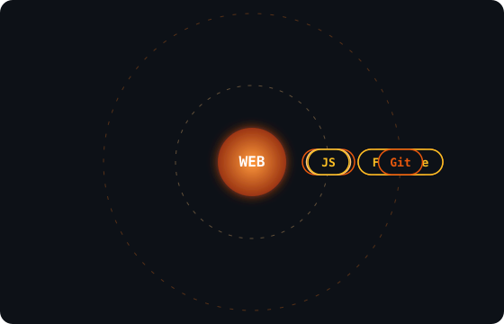
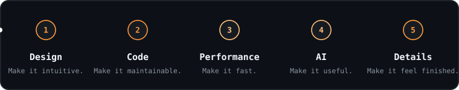

<!-- ============================================================
  JMMM11 - Profile README (tema naranja, v5)
  Repo requerido: github.com/JMMM11/JMMM11
  Archivos propios que usa este README (van en la carpeta assets/):
    assets/banner.svg         -> banner ASCII animado
    assets/divider.svg        -> linea divisora animada
    assets/web-workspace.svg  -> espacio de desarrollo web animado
    assets/now.svg            -> terminal de estado actual
    assets/tech-orbit.svg     -> tecnologias orbitando
    assets/skills.svg         -> barras de enfoque animadas
    assets/project-card.svg   -> plantilla de tarjeta de proyecto
    assets/project-1..4.svg   -> tarjetas de proyectos (Hands, Hydronexis, HealthBoost, PanaRoots)
    assets/mindset.svg        -> pipeline animado de la seccion 07
  Paleta: naranja (#ff7a18) · ambar · coral · durazno
============================================================ -->

<div align="center">



<br>

<a href="https://github.com/JMMM11">
  
</a>

<br>


<a href="https://github.com/JMMM11?tab=followers"></a>
<a href="https://github.com/JMMM11?tab=repositories"></a>

</div>

<br>


<!-- ======================= 01 ======================= -->


<table>
<tr>
<td width="55%" valign="top">

I'm a developer focused on building **modern, functional and polished web experiences** designed to work beautifully on computers.

I enjoy working across the entire product lifecycle: from the first idea and interface design to application logic, databases and intelligent features.

> **I don't just want to build software that works.**
> **I want to build software that feels finished.**

</td>
<td width="45%" valign="top">



</td>
</tr>
</table>

<!-- ======================= 02 ======================= -->


<table>
<tr>
<td width="25%" align="center">
<h3>Building</h3>
<sub>Web applications<br>and digital products</sub>
</td>
<td width="25%" align="center">
<h3>Exploring</h3>
<sub>Artificial Intelligence<br>and intelligent interfaces</sub>
</td>
<td width="25%" align="center">
<h3>Developing</h3>
<sub>Full-stack apps and<br>modern architectures</sub>
</td>
<td width="25%" align="center">
<h3>Learning</h3>
<sub>New tech, dev practices<br>and product design</sub>
</td>
</tr>
</table>

<div align="center">

<br>



</div>

<br>

<!-- ======================= 03 ======================= -->


<div align="center">



<br><br>

<table>
<tr>
<td align="center" width="33%">
<b>Frontend</b><br><br>
<br>
<sub>HTML · CSS · JavaScript · TypeScript · Three.js</sub>
</td>
<td align="center" width="33%">
<b>Backend</b><br><br>
<br>
<sub>Python · Java · C++ · APIs · Authentication</sub>
</td>
<td align="center" width="34%">
<b>Data</b><br><br>
<br>
<sub>Supabase · Firebase · SQL</sub>
</td>
</tr>
</table>

<br>


<br><br>



</div>

<details>
<summary><b>Ver la arquitectura de como construyo (clic para abrir)</b></summary>

<br>

```text
   [ UI / Responsive Web ]
              │
              ▼
   [ API · Python · Auth ]
              │
              ▼
   [ Supabase · Firebase ]
              │
              ▼
   [ Producto que se siente terminado ]
```

</details>

<br>


<!-- ======================= 04 ======================= -->


<!-- Tarjetas generadas: para cambiar textos o etiquetas, edita assets/project-N.svg -->

<table>
<tr>
<td width="50%" align="center">
<a href="https://github.com/JMMM11/Hands">
  
</a>
<sub><a href="https://jmmm11.github.io/Hands/">Live demo</a> &nbsp;·&nbsp; <a href="https://github.com/JMMM11/Hands">Source</a></sub>
</td>
<td width="50%" align="center">
<a href="https://github.com/JMMM11/Hydronexis">
  
</a>
<sub><a href="https://jmmm11.github.io/Hydronexis/">Live demo</a> &nbsp;·&nbsp; <a href="https://github.com/JMMM11/Hydronexis">Source</a></sub>
</td>
</tr>
<tr>
<td width="50%" align="center">
<a href="https://github.com/JMMM11/HealthBoost">
  
</a>
<sub><a href="https://jmmm11.github.io/HealthBoost/">Live demo</a> &nbsp;·&nbsp; <a href="https://github.com/JMMM11/HealthBoost">Source</a></sub>
</td>
<td width="50%" align="center">
<a href="https://github.com/JMMM11/Panaroots">
  
</a>
<sub><a href="https://jmmm11.github.io/Panaroots/">Live demo</a> &nbsp;·&nbsp; <a href="https://github.com/JMMM11/Panaroots">Source</a></sub>
</td>
</tr>
</table>

<div align="center">

<br>

<a href="https://github.com/JMMM11/Digital-Portafolio"></a>
<a href="https://github.com/JMMM11?tab=repositories"></a>

</div>


<!-- ======================= 05 ======================= -->


<div align="center">


<br><br>

</div>

<!-- ======================= 06 ======================= -->


<div align="center">


<br><br>

<picture>
  <source media="(prefers-color-scheme: dark)" srcset="https://raw.githubusercontent.com/JMMM11/JMMM11/output/github-snake-dark.svg" />
  <source media="(prefers-color-scheme: light)" srcset="https://raw.githubusercontent.com/JMMM11/JMMM11/output/github-snake.svg" />
  
</picture>

<br><br>


</div>


<!-- ======================= 07 ======================= -->


<div align="center">



</div>

<!-- ======================= 08 ======================= -->


<div align="center">

I don't believe in adding technology simply because it is popular.
Every tool should have a purpose.

<br>

**Clean code &nbsp;+&nbsp; thoughtful design &nbsp;+&nbsp; useful functionality**

</div>


<div align="center">


Interested in technology, software, AI or building something interesting?

<br>

<a href="https://github.com/JMMM11"></a>
<a href="mailto:jairm9010@gmail.com"></a>
<a href="https://www.java.com/"></a>
<a href="https://www.python.org/"></a>

<br><br>

`BUILD` · `LEARN` · `IMPROVE` · `REPEAT`

<sub>Code · Ideas · Real Impact</sub>


</div>